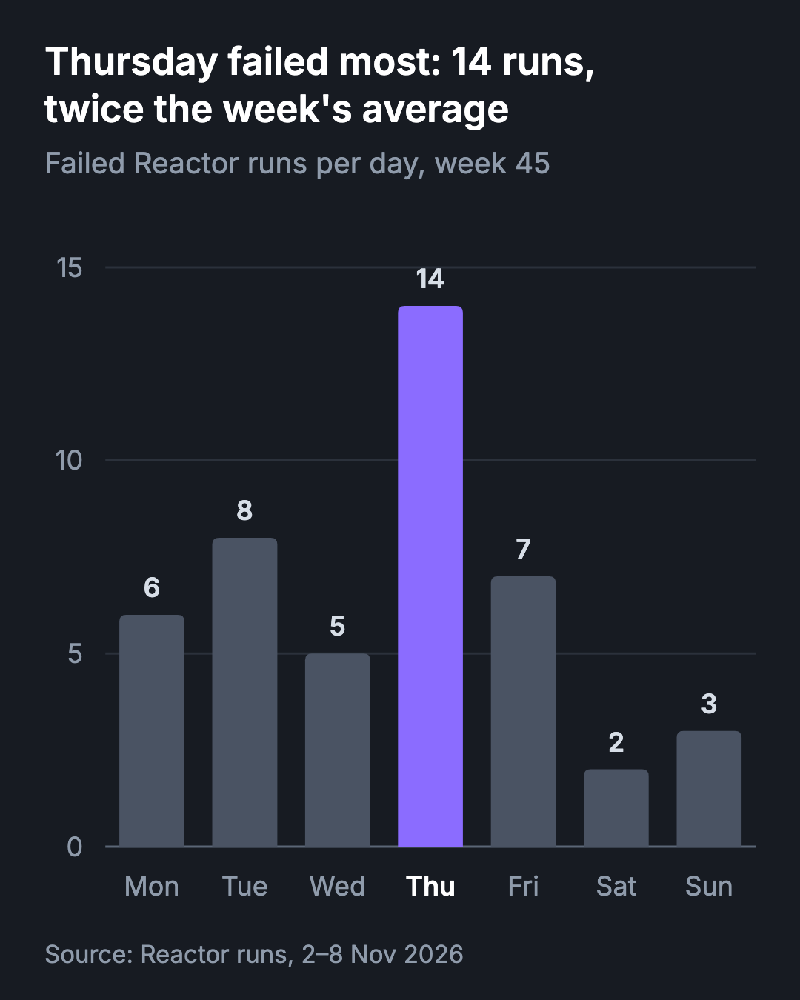
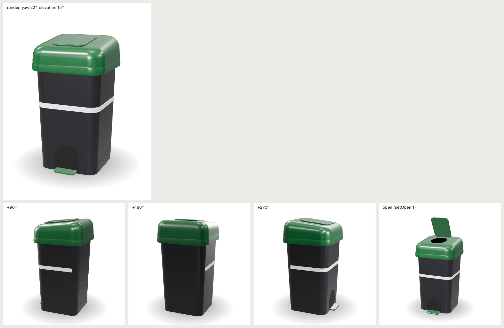
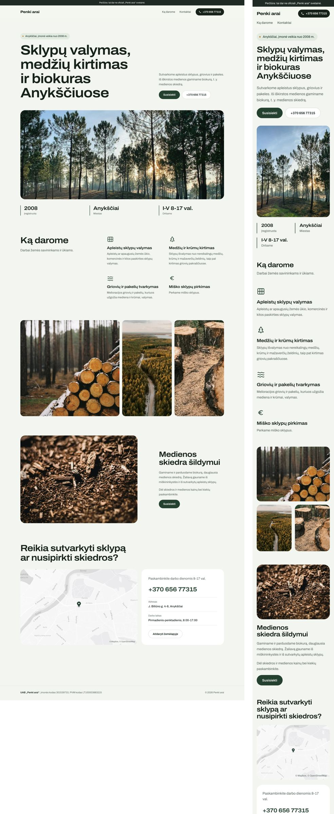

# selan-skills

Skills for [Claude Code](https://claude.com/claude-code) from [Selan](https://selan.ai). Companies on Selan get them
installed with Claude Code; anyone else can add them:

```
/plugin marketplace add selan-ai/selan-skills
/plugin install selan-skills@selan-skills
```

## charts

Ask for a chart, or for numbers a chart would answer better, and Claude draws it in Selan's style: a PNG and an SVG,
with the numbers beside it as a CSV. In a Selan Reactor chat, the expert attaches the PNG to its reply.


Bar, horizontal bar, line, stacked bar and donut, dark or light, wide, square or tall, or `phone` for a chart in a
chat reply on the Selan app. The title says the takeaway, bars start at zero, labels sit on the data rather than in a
legend, and one category can be kept in colour while the rest go grey. The spec for the chart above is
[examples/failed-runs.json](examples/failed-runs.json); the same chart at `phone`, as an agent attaches it to a chat
reply, is [examples/failed-runs-phone.json](examples/failed-runs-phone.json):



It needs only Python 3.9 or later. The PNG is drawn by the first of rsvg-convert, resvg, Chrome or Chromium (including
Playwright's) the machine has, or Quick Look on a Mac; with none of them, you get the SVG and the CSV.

```
/selan-skills:charts   or just: "chart the failed runs per day this week"
```

## product-3d

Give it one photo of a product and Claude rebuilds it as a turnable 3D model written in code (three.js), checks it
against the photo round by round, and packs it for a web page or a slide deck.



Each round renders the model over the photo at 50%, fitted to the object's box in it, and from the sides the photo
does not show, so a wrong proportion is an outline that does not line up. Moving parts (a lid, a pedal, a door)
open with a button or a click on the model. The export is one script, about 200 KB gzip, that loads only when the
visitor asks (a page) or the slide comes near (a deck), and works from a deck opened from disk. With `--ar` it also
writes GLB and USDZ files at the product's real size and a "view in your space" link, for AR Quick Look on an iPhone
or iPad and Scene Viewer on Android.

For hard products on a plain background: bins, boxes, bottles, tools, fasteners, housings. It is a likeness, not a
measurement; for exact dimensions, start from the CAD file. It needs Python 3.9 or later and Chrome or Chromium
(including Playwright's); three.js comes with the skill.

```
/selan-skills:product-3d   or just: "make this product photo a 3D model for the website"
```

## selan-site-design

How a Selan Modernise website looks: three templates of one family (Panorama, Split, Harbour) chosen by the
company's field, the owner's hard rules (sentence-case short headings, real or stock photos credited only in the
report, no dashes, SVG logos, a pre-rendered map, nothing invented) and the visual QA a preview passes before anyone
sees it. The code it describes is `rebuild/` in selan-modernise-web-project.



```
/selan-skills:selan-site-design   or just: "rebuild this company's site as a Selan preview"
```

## License

MIT
