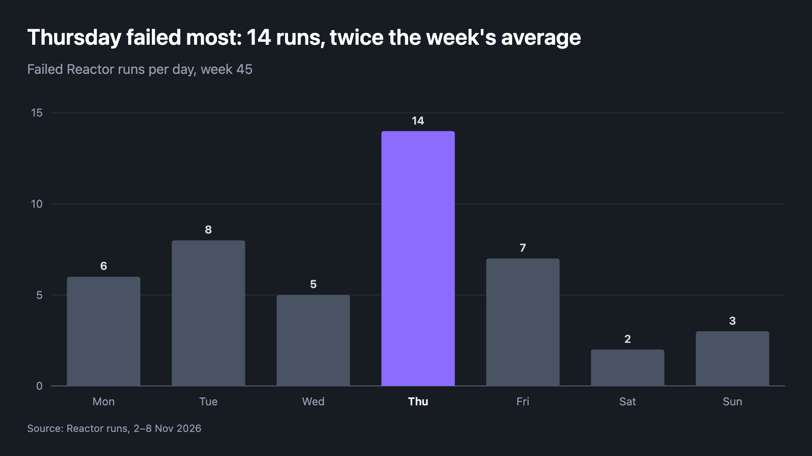

# selan-skills

Skills for [Claude Code](https://claude.com/claude-code) from [Selan](https://selan.ai). Companies on Selan get them
installed with Claude Code; anyone else can add them:

```
/plugin marketplace add selan-ai/selan-skills
/plugin install selan-skills@selan-skills
```

## charts

Ask for a chart, or for numbers a chart would answer better, and Claude draws it in Selan's style: a PNG and an SVG,
with the numbers beside it as a CSV. In a Selan Reactor chat, the expert attaches the PNG to its reply.



Bar, horizontal bar, line, stacked bar and donut, dark or light, wide, square or tall for a phone. The title says the
takeaway, bars start at zero, labels sit on the data rather than in a legend, and one category can be kept in colour
while the rest go grey. The spec for the chart above is [examples/failed-runs.json](examples/failed-runs.json).

It needs only Python 3.9 or later. The PNG is drawn by the first of rsvg-convert, resvg, Chrome or Chromium (including
Playwright's) the machine has, or Quick Look on a Mac; with none of them, you get the SVG and the CSV.

```
/selan-skills:charts   or just: "chart the failed runs per day this week"
```

## License

MIT
